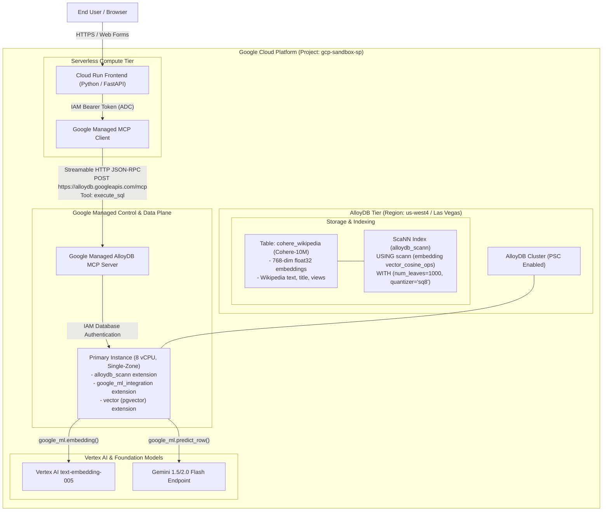

# SPEC.md: AlloyDB AI Functions Demo & Architecture Specification

## 1. Executive Summary & Objective

This project demonstrates a production-grade, end-to-end architecture showcasing **Google Cloud AlloyDB for PostgreSQL** and all of its **Generally Available (GA)** AI capabilities. The system connects an interactive Python web frontend hosted on **Cloud Run** to AlloyDB via the **Google Managed Model Context Protocol (MCP) Server** (`https://alloydb.googleapis.com/mcp`), adhering strictly to Google Cloud security and performance best practices:

- **Zero Stored Credentials / Keys:** Pure IAM-based authentication for both Cloud Run, MCP, and database access.
- **Enterprise Network Architecture:** Private Service Connect (PSC) in the **Las Vegas (`us-west4`)** region.
- **Compute Sizing:** 8 vCPU, single-zone primary instance.
- **High-Performance Vector Indexing:** Google ScaNN (`alloydb_scann`) index configured for 768-dimensional Cohere-10M vector embeddings.
- **Transparent Query Execution:** Interactive UI exposing real-time SQL statements and `EXPLAIN ANALYZE` execution plans for every AI operation.

---

## 2. High-Level Architecture

The architecture decouples the user-facing web tier from the database tier via Google's managed remote MCP endpoint. The Cloud Run service acts as an MCP client, issuing authenticated JSON-RPC tool calls to execute SQL statements and retrieve `EXPLAIN ANALYZE` metrics.



---

## 3. Dataset Analysis: Cohere-10M

The demo utilizes the industry-standard **Cohere-10M** dataset (derived from `Cohere/wikipedia-22-12` embeddings benchmarked in vector search evaluations).

### 3.1 Schema & Column Semantics

| Column Name | PostgreSQL Type | Description & Semantics |
| :--- | :--- | :--- |
| `id` | `BIGINT PRIMARY KEY` | Unique 64-bit integer identifier for each Wikipedia passage chunk. |
| `title` | `TEXT` | Title of the parent Wikipedia article. Used for filtering and contextual search. |
| `text` | `TEXT` | Raw textual body of the Wikipedia paragraph chunk (~100–300 words). |
| `url` | `TEXT` | Canonical web URL pointing to the source Wikipedia page. |
| `views` | `INTEGER` | Annual or 30-day page view count of the article; serves as a ranking and popularity signal. |
| `langs` | `TEXT` | Language code (e.g. `en`) or language count indicator. |
| `embedding` | `vector(768)` | Dense 768-dimensional `float32` vector embedding generated via Cohere's embedding model on `title + " " + text`. |

### 3.2 Data Ingestion & Storage Sizing
- A full 10-million row vector table with 768 dimensions consumes **~35 GB** of raw vector binary data plus text fields and index overhead.
- For interactive demonstration and rapid indexing, the loader imports representative slices (e.g., 50,000–500,000 rows) with the identical schema and indexing configuration, scaling up seamlessly as storage requirements dictate.

---

## 4. AlloyDB AI Functions: GA vs. Preview Matrix

Per the official Google Cloud documentation (`cloud.google.com/alloydb/docs/ai`), AI features are divided into Generally Available (GA) and Preview capabilities:

| Feature / SQL Function | Lifecycle Status | Extension Required | Purpose & Notes | Included in Demo |
| :--- | :---: | :--- | :--- | :---: |
| **`google_ml.embedding()`** | **GA** | `google_ml_integration` | Generates text or multimodal embeddings directly in SQL using Vertex AI (e.g., `text-embedding-005`). | **Yes (Primary)** |
| **`google_ml.predict_row()`** | **GA** | `google_ml_integration` | Invokes remote ML and LLM endpoints (e.g., Gemini) with JSON payloads from SQL. | **Yes (Primary)** |
| **Google ScaNN Index** | **GA** | `alloydb_scann` | High-throughput, low-memory ANN vector index using Vector Quantization and Anisotropic Vector Quantization. | **Yes (Primary)** |
| **Model Endpoint Management** | **GA** | `google_ml_integration` | `google_ml.create_model`, `google_ml.alter_model`, `google_ml.drop_model` to manage model metadata. | **Yes (Primary)** |
| **Vector Similarity Ops** | **GA** | `vector` (`pgvector`) | Distance operators: `<=>` (Cosine), `<->` (L2 / Euclidean), `<#>` (Negative Inner Product). | **Yes (Primary)** |
| `ai.if()` | Preview | `google_ml_integration` | Semantic boolean filtering via LLM query engine. | Highlighted in UI |
| `ai.rank()` | Preview | `google_ml_integration` | Natural language reranking operator. | Highlighted in UI |
| `ai.generate()` | Preview | `google_ml_integration` | In-database text generation / LLM transformation. | Highlighted in UI |
| `ai.summarize()` / `ai.agg_summarize()` | Preview | `google_ml_integration` | In-database text summarization. | Highlighted in UI |
| `ai.classify()` / `ai.extract()` | Preview | `google_ml_integration` | Text classification and structured JSON extraction. | Highlighted in UI |

---

## 5. ScaNN Index Design & Tuning

AlloyDB ScaNN (`alloydb_scann`) is Google’s proprietary vector indexing engine, outperforming standard HNSW in both build speed and query throughput while using significantly less RAM.

### 5.1 DDL Definition
```sql
CREATE INDEX IF NOT EXISTS cohere_scann_idx 
ON cohere_wikipedia 
USING scann (embedding vector_cosine_ops)
WITH (
    num_leaves = 1000,
    quantizer = 'sq8'
);
```

### 5.2 ScaNN Parameters Explained
- **`num_leaves`**: The number of partitions (centroids) created during K-Means clustering. For $N$ vectors, a common rule of thumb is $\approx \sqrt{N}$ or $2 \times \sqrt{N}$ (e.g., 1,000 leaves for 100k–1M vectors).
- **`quantizer`**: Set to `'sq8'` (Scalar Quantization to 8-bit integers). Compresses 32-bit floats by $4\times$, drastically reducing memory footprint while preserving $>98\%$ recall.
- **Runtime Search Tuning**:
  ```sql
  SET scann.num_leaves_to_search = 50;
  SET scann.pre_reorder_num_neighbors = 200;
  ```
  Controls the speed/recall trade-off at query time without rebuilding the index.

---

## 6. Secure Connectivity & Best Practices

1. **IAM Authentication (`alloydb.iam_authentication=on`)**:
   - Database users are authenticated via Google Cloud IAM.
   - Zero database passwords stored in application environment variables or configuration files.
2. **Google Managed Remote MCP Server**:
   - Endpoint: `https://alloydb.googleapis.com/mcp`
   - Authentication: Bearer token obtained automatically from Cloud Run's Application Default Credentials (ADC) / Compute Service Account.
   - Tool Invocation: `tools/call` with tool name `execute_sql` specifying `instance`, `database`, and `sqlStatement`.
3. **Private Service Connect (PSC)**:
   - AlloyDB cluster configured with `--enable-private-service-connect` and `--allowed-psc-projects=gcp-sandbox-sp`.
   - Eliminates VPC peering IP overlap risks and confines network routing to Google's internal SDN.
4. **AlloyDB Instance Sizing**:
   - Region: `us-west4` (Las Vegas)
   - CPU Count: `8` vCPUs
   - Availability: `ZONAL` (single zone)
   - Flag `--require-connectors` to reject unauthenticated / plain TCP traffic.

---

## 7. Interactive Frontend Features

The Cloud Run web application provides:

1. **Embedding Generation Lab (`google_ml.embedding`)**:
   - Interactive prompt input.
   - Generates 768-dimensional vector using Vertex AI `text-embedding-005` in-database.
   - Displays real-time generated SQL and vector dimensionality inspect tools.
2. **Semantic Vector Search with ScaNN**:
   - Natural language search query converted to embedding.
   - Top-$K$ nearest neighbors computed via ScaNN index using cosine distance (`<=>`).
   - Displays article title, chunk text, page views, and similarity score ($1 - \text{distance}$).
3. **Hybrid Search (ScaNN + Structured SQL Filters)**:
   - Vector similarity filtered by popularity (`views > :threshold`) and article titles.
4. **Predict Row Studio (`google_ml.predict_row`)**:
   - Executes Gemini predictions on retrieved database rows directly within SQL (e.g. summarizing a Wikipedia chunk or extracting key facts).
5. **SQL & Execution Plan (`EXPLAIN ANALYZE`) Visualizer**:
   - Side-by-side view showing the exact SQL statement dispatched.
   - Full `EXPLAIN (ANALYZE, BUFFERS)` execution plan with execution time, ScaNN Index Scan validation, and planning overhead.
